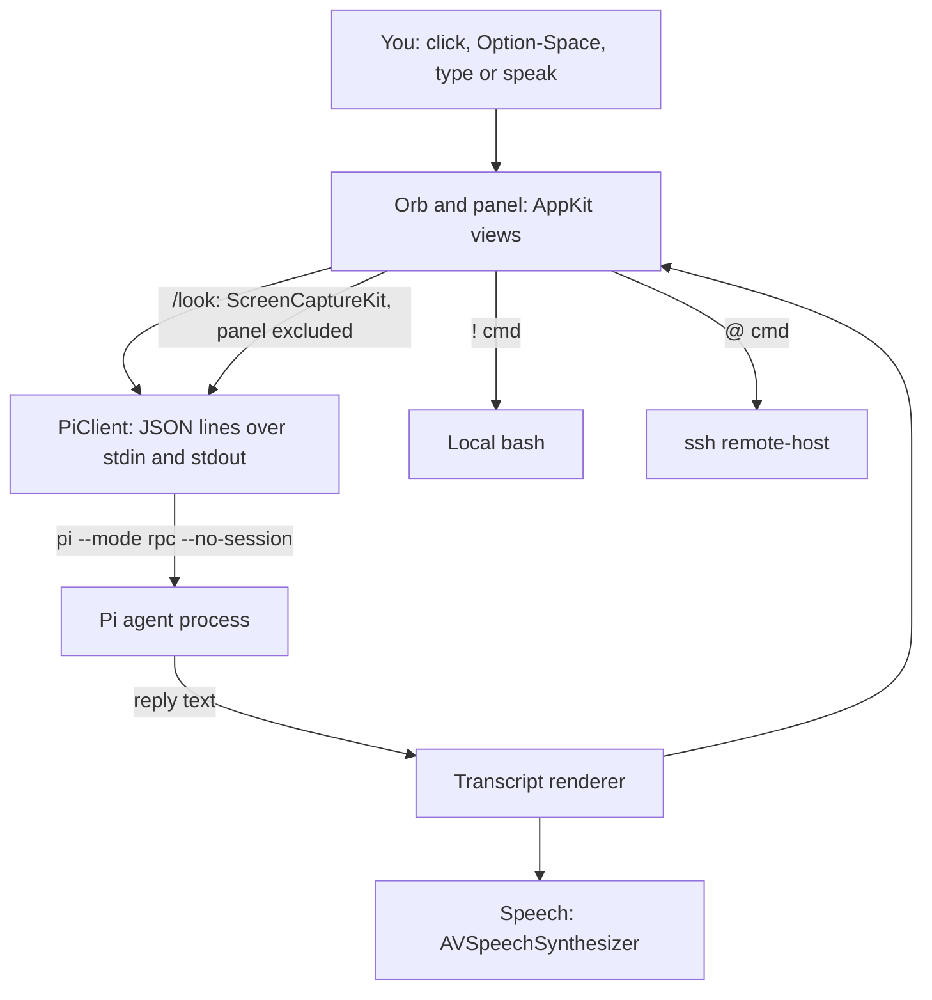

# kodros-orb

A floating orb for macOS. Click it and a panel opens where you type or speak to the Pi coding agent, share your screen with it and run shell commands. It is a native Swift app with no Dock icon and no menu-bar item. Right-click the orb for its menu.

Part of the [Kodros](https://kodros.ai) agent tooling. Version 2.1, bundle `ai.meshvault.piorb`, executable `PiOrb`.

## On your hardware

- Does: a panel on one Mac for talking to the Pi coding agent. The Mac needs no GPU.
- Needs: macOS 14 or later on Apple silicon, and the `pi` program. The model runs wherever your Pi setup points.
- Stays on-prem: the orb itself makes no network calls. It talks to the local `pi` process. Whether model traffic stays on your network depends on the provider you configured in Pi, so check that. A built-in shortcut selects provider `qwen-token-plan` and model `qwen3.8-max-preview`. Qwen is China-origin.

## How it works



Static diagram: [docs/architecture.svg](docs/architecture.svg). Step-by-step build: [BUILD.md](BUILD.md).

The app starts one `pi` process in RPC mode and talks to it over pipes. Replies stream into the panel and can be spoken aloud. Typing `/help` lists every command. A line that starts with `!` runs in local bash, and one that starts with `@` runs over SSH on a host you name `remote-host` in `~/.ssh/config`. Option-Space opens the panel and Escape collapses it.

The app needs a stable code-signing identity because macOS drops Screen Recording, Microphone and Speech Recognition grants when an app is signed ad hoc. `build.sh` refuses to build without one.

## Stack

Swift with AppKit, AVFoundation, Speech and ScreenCaptureKit. No packages. The Pi agent is a separate program you install yourself.

## Run

Needs macOS 14 or later on Apple silicon, `swiftc`, a code-signing identity in your keychain, and the `pi` executable. The app finds `pi` through `$PI_EXECUTABLE`, then `~/.local/bin/pi`, `~/.local/share/pi-node/current/bin/pi`, `/opt/homebrew/bin/pi` and `/usr/local/bin/pi`.

```bash
./install.sh    # builds, copies to ~/Applications, installs and starts a LaunchAgent
./build.sh      # build only
```

macOS asks for microphone, speech and screen-recording access on first use. Logs go to `~/Library/Logs/PiOrb.log` and `PiOrb.error.log`. Full steps and the signing setup are in [BUILD.md](BUILD.md).

Test the Pi client on any host with Swift, Linux included:

```bash
swiftc Sources/PiClient.swift Sources/SlashCommandCompletion.swift Sources/Speakable.swift Tests/PiClientTests.swift -o /tmp/orb-tests
PI_EXECUTABLE="$PWD/Tests/Fixtures/fake-pi" /tmp/orb-tests
```

## Limits

- A local tool, installed by hand. It has no release channel, no website and no CI. Only the Pi client has automated tests (9 tests). The panel, voice and screen sharing are checked by hand on a Mac.
- `/vault` and `/graphify` call helper programs that are not in this repository (`~/.meshvault/tooling/bin/meshvault-skill` and `~/.local/bin/graphify-recall`). Without them those commands print an error.
- `!` and `@` run whatever you type with your own permissions. There is no sandbox.
- The signing identity name defaults to `MeshVault Local Code Signing`. Set `SIGN_IDENTITY` to use another.

## License

Copyright 2026 Tanner Osterkamp. All rights reserved. See [LICENSE](LICENSE). The source is public to read; ask before reuse.
